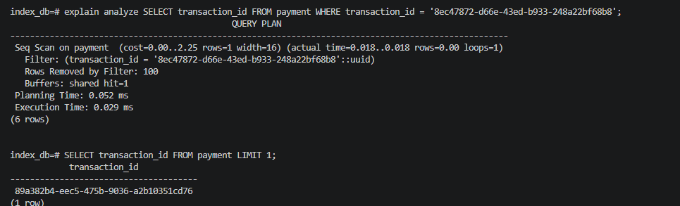
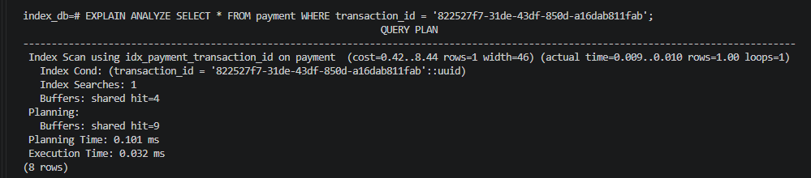
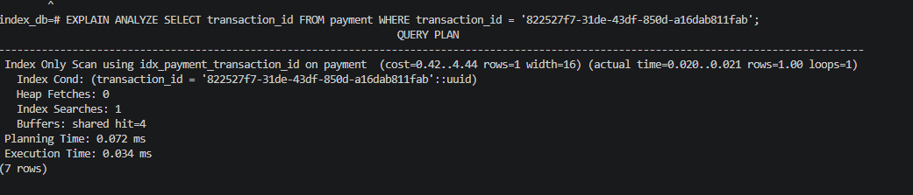

# PostgreSQL: EXPLAIN ANALYZE and Scan Types

## What is EXPLAIN ANALYZE?

`EXPLAIN ANALYZE` is a PostgreSQL command that shows how the database executes a query and how long each step takes. It actually **runs** the query, so it reports real timings next to the planner's estimates.

```sql
EXPLAIN ANALYZE SELECT * FROM payment WHERE status = 'completed';
```

## Scan types

When reading a table, PostgreSQL usually uses one of these strategies:

- **Sequential Scan**: reads the whole table, row by row.
- **Index Scan**: uses an index to find matching rows, then reads those rows from the table.
- **Index Only Scan**: gets everything it needs from the index, without reading the table.
- **Bitmap Scan**: uses an index to collect the pages that contain matches, then reads those pages in order. It's common when a query matches a moderate number of rows.

### Sequential Scan

A query without a `WHERE` clause has to read every row, so PostgreSQL uses a sequential scan:

```sql
SELECT * FROM payment;
```

A sequential scan can also happen **with** a filter:

```sql
SELECT * FROM payment WHERE transaction_id = 'your-uuid-here';
```

This happens when there is no index on the column, or when the table is small enough that PostgreSQL decides reading it all is cheaper than using an index (even if one exists).



### Improving it with an index

To speed up searches by `transaction_id`, create an index:

```sql
CREATE INDEX idx_payment_transaction_id ON payment (transaction_id);
```

By default this creates a **B-tree**, a data structure that lets PostgreSQL find the matching rows without reading the whole table. The gain is largest on big tables and selective filters (queries that return few rows). The trade-off is extra disk space and slightly slower writes, since the index must be kept up to date.

### Index Scan vs Index Only Scan

Once PostgreSQL finds a match in the index, there are two possibilities:

- **Index Scan**: the index gives the location of the row, and PostgreSQL then fetches the full row from the table.
- **Index Only Scan**: if the query only needs columns stored in the index, PostgreSQL answers from the index alone and skips the table read.

-- Index Scan: needs all columns, so it must visit the table


-- Index Only Scan: transaction_id is the only column needed, and it is in the index


> Index Only Scans also depend on the table being recently vacuumed (the visibility map), so right after a bulk insert you may still see some table reads. Running `VACUUM payment;` fixes this.

## Useful commands

Estimated number of rows (instant, approximate):

```sql
SELECT n_live_tup AS estimated_rows
FROM pg_stat_user_tables
WHERE relname = 'payment';
```

Exact number of rows (slower on large tables):

```sql
SELECT count(*) FROM payment;
```